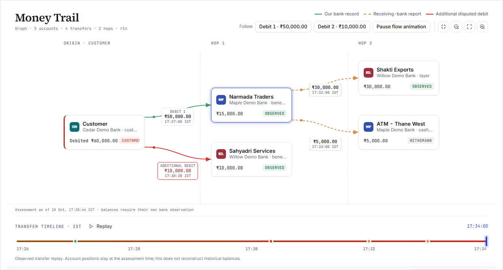

<div align="center">

# CaseProof

### A justified first response to a payment scam.

Turn a customer's report, scattered evidence and bank records into a cited investigation brief, a visible money trail and a reviewer-approved handoff.

**Built for bank fraud-response analysts. Powered by Google Cloud.**

[**Try the live golden-hour tour →**](https://8-233-217-230.sslip.io/app/?tour=start#/victim/start) · [Explore the workflow](#from-first-report-to-reviewed-handoff) · [Run locally](#run-it-locally)

Synthetic practice data · No sign-in required for the demo · Separate analyst and reviewer personas

</div>

<br>



<p align="center"><em>Follow the bank-reported path of a disputed payment. Every case uses its own records; amounts and account counts change with the evidence.</em></p>

## The first hour needs a clear next action

A customer says someone from the bank told them to transfer money to a “safe account”. They have a receipt, a chat and a call log. Another debit might be related. The money has already moved onward.

The analyst has to establish which payments belong to the complaint, reconcile the evidence with bank records, find the important gaps and prepare a defensible referral. The reviewer needs to know exactly what is being authorised.

CaseProof brings that work into one investigation workspace. Start with the response window and recommended action. Verify a finding against its original source. Trace the disputed money. Ask the customer only for information still missing. Send the exact report an independent reviewer approved.

## From first report to reviewed handoff

| Step | What happens | Why it matters |
| --- | --- | --- |
| **1 · Report** | The customer selects their payments, explains what happened and attaches evidence. | The customer's account and the bank's ledger remain distinct. Extra debits are never disputed automatically. |
| **2 · Prioritise** | The new complaint appears in the analyst queue with a bank-timed golden-hour signal. | Urgency comes from the payment timestamp, rather than a model's estimate. |
| **3 · Investigate** | A brief connects findings to source evidence and bank matches. The Money Trail shows reported onward movements. | The analyst can inspect the basis for an action instead of trusting an unexplained summary. |
| **4 · Clarify** | The analyst sends a focused request. The customer answers through an expiring, scoped reply link. | New information produces a new assessment; old approvals cannot silently carry forward. |
| **5 · Review** | A separate reviewer checks readiness, writes a rationale and approves the current revision and digest. | Investigation and authorisation stay separate. |
| **6 · Handoff** | The approved packet goes to two synthetic receivers. A named owner and next action remain on the case. | Both acknowledgements and follow-up are visible. Sending is not mistaken for resolution. |

## See the evidence behind the decision

### A brief you can check

Read the supported findings, matched payments and unresolved matters together. Open a citation to inspect the original evidence. Customer statements, extracted details and bank verification keep their own meaning.

### A money trail you can inspect

Follow each confirmed disputed debit through the reported account network. Inspect transfer times, source records and observation limits. Replay shows the recorded sequence without inventing historical balances.

### Questions with a purpose

Send a proposed request for an unresolved gap, rather than asking for facts the bank already has. Preserve the customer's reply, uploaded evidence and the assessment it changes.

### Approval tied to what was reviewed

Approve the current revision and digest with a written reason. A later evidence or bank-data change requires a fresh review. Track both delivery acknowledgements and the next person responsible.

## The output: an investigation report someone can act on

The analyst's deliverable is a **source-linked payment-scam investigation report**, backed by a reviewed case snapshot. It includes the payment inventory, supported findings, unresolved information, traced money movements and source references. Delivery preserves the approved packet and its history.

Open **Delivery & follow-up → View delivered report** to inspect the readable, printable document. The case stays open for receiving-bank responses, with an owner and next action.

**Delivery does not mean a freeze, refund, regulatory filing or closed investigation.** The demo receivers acknowledge synthetic packets; they do not move or recover real funds.

## Try a fresh golden-hour case

[**Start the guided demonstration →**](https://8-233-217-230.sslip.io/app/?tour=start#/victim/start)

1. Choose **10 minutes ago** and start a fresh practice session.
2. Select a customer marked with a suspicious payment. Report that payment, describe the scam and upload a receipt, chat or call log.
3. Continue as analyst. Inspect the alert, brief, source evidence and Money Trail.
4. Resolve the case's missing information and explicitly confirm or exclude additional payments.
5. Switch to reviewer when the case is ready. Approve the current version, send the packet and verify both acknowledgements.
6. Return to analyst, save follow-up ownership and inspect the delivered report.

Each session generates a fictional bank, customers, payments and downstream observations. Choose **10 minutes**, **40 minutes** or **2 hours ago** to compare response priority. The complaint, evidence processing, assessment, review and delivery run through the backend; the demo does not replay a fixed completed case.

Use fictional information only. Stay in the same browser to keep the victim and staff views in the same practice session. See the [complete demonstration guide](docs/GOLDEN_HOUR_DEMO_AND_RELEASE_CHECK.md) for the detailed path and recovery checks.

## AI assistance. Explicit decision controls.

Google Cloud provides the deployed runtime and evidence-processing services. Document AI reads uploaded images; Gemini on Vertex AI supports evidence interpretation and investigation assistance. Backend code owns financial calculations, money allocations, readiness and revision checks. A human reviewer authorises the handoff.

| Capability | Google Cloud runtime |
| --- | --- |
| React frontend, workflow API and private worker | Cloud Run, behind a shared HTTPS origin |
| Image OCR and AI assistance | Document AI and Vertex AI Gemini |
| Evidence and immutable exported packets | Cloud Storage |
| Case state, revisions, approvals and audit | Firestore Native |
| Synthetic bank records and downstream observations | BigQuery |
| Durable background work and reconciliation | Cloud Tasks and Cloud Scheduler |

The public deployment is a **synthetic staging prototype**, not a production bank integration. Its labelled demo personas are scoped to the visitor's practice session. Production staff sign-in, institutional integrations and operational controls require separate validation. See [architecture](docs/ARCHITECTURE.md), [security](docs/SECURITY.md) and [deployment details](docs/DEPLOYMENT.md).

## Run it locally

Requires Docker Desktop in Linux-container mode. No cloud credentials are needed.

```sh
docker compose up --build -d --wait
```

Open [the local application](http://127.0.0.1:8080/). Initial startup prepares synthetic bank records and creates no complaints. Local evidence processing uses Tesseract and explicit extraction rules; cloud AI features depend on the selected provider configuration.

<details>
<summary><strong>Local services and data</strong></summary>

| Service | Responsibility | Persistent data |
| --- | --- | --- |
| `frontend` | Nginx serves React and proxies API requests | None |
| `api` | FastAPI workflow API, customer sessions and readiness | `application-data` |
| `worker` | Jobs, bank observations and outbound delivery | `application-data` |
| `ocr` | Tesseract image OCR | None |
| `trail-feed` | Independent synthetic downstream-bank feed | `feed-data` |
| `simulator` | Two idempotent synthetic report receivers | `simulator-data` |
| `preload` | One-shot fictional bank preload | `application-data` |

Only the frontend publishes a port, bound to host loopback. Stop with `docker compose stop`; resume with `docker compose up -d`. Removing volumes discards local investigation data.

</details>

## Explore the implementation

| Start here | What you will find |
| --- | --- |
| [Frontend](frontend/) | React/Vite application, source inspection, graph presentation and UI tests |
| [Workflow and domain](caseproof/) | Financial rules, readiness, approvals, jobs and storage adapters |
| [API contract](docs/API_WORKFLOW_CONTRACT.md) | Payload semantics, roles, revisions and recovery invariants |
| [Testing](docs/TESTING.md) | Regression coverage, evaluation methods and known limits |
| [Golden-hour verification](docs/GOLDEN_HOUR_DEMO_AND_RELEASE_CHECK.md) | Reproducible demonstration and recorded local UI checks |
| [Google infrastructure](infra/google/) | Cloud runtime, service boundaries and deployment gates |
| [Backlog](BACKLOG.md) | Remaining product and operational work |

The older `/inspector` interface is available for local technical diagnostics. The React application is the primary product experience.

---

<div align="center">

**Follow one complaint all the way to its reviewed output.**

[**Try CaseProof →**](https://8-233-217-230.sslip.io/app/?tour=start#/victim/start)

Built by **BuildtoChange** · [MIT License](LICENSE)

</div>
